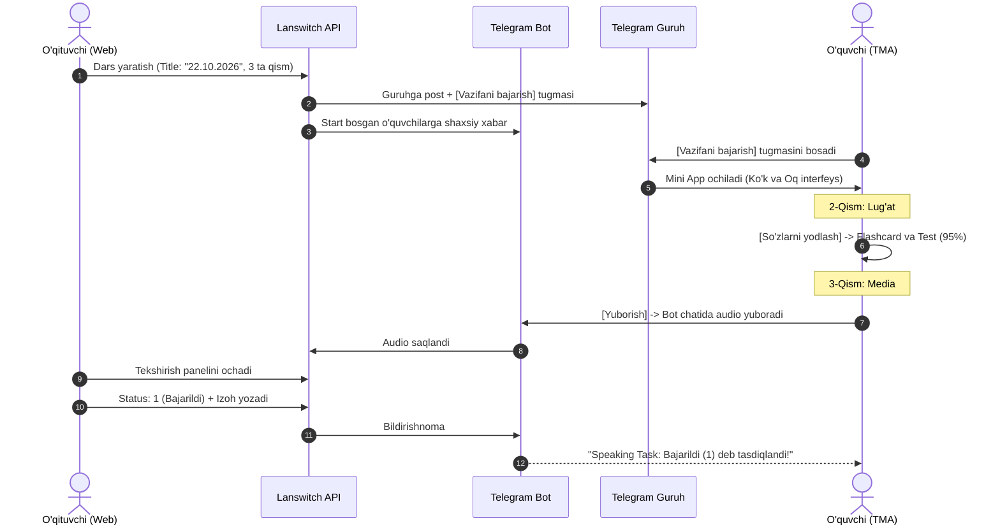
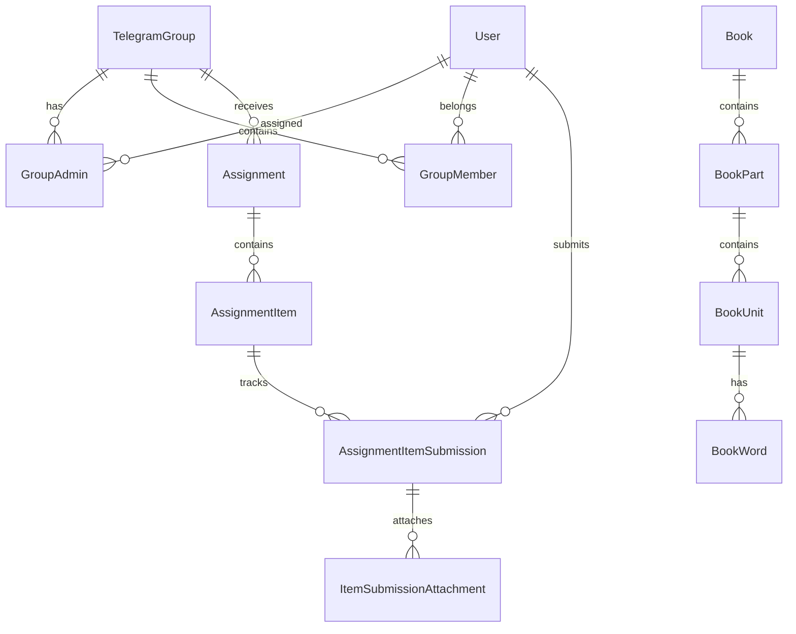

# 🎬 LANSWITCH — TELEGRAM GURUHLARIGA ASOSLANGAN INGLIZ TILI O'RGATISH PLATFORMASI
## TO'LIQ TEXNIK TOPSHIRIQ VA DIZAYN TIZIMI (TECHNICAL & DESIGN SPECIFICATION)

> **Loyiha Falsafasi:**  
> - **Fokus:** O'zbek auditoriyasiga ingliz tilini o'rgatish (EN <-> UZ).  
> - **Asos:** 100% Telegram Superguruhlari va Telegram Cloud infratuzilmasi.  
> - **Dizayn Uslubi:** **Ko'k va Oq (Blue & White)** ranglar uyg'unligi, **yumaloq (rounded)** shakllar, **oddiy, toza va katta-katta (big, spacious, touch-friendly)** interfeys elementlari.  
> - **Mijozlar:** O'quvchilar uchun — **Telegram Mini App (TMA)** (O'zbekcha), O'qituvchilar uchun — **Mobile-First Responsive Web** (Inglizcha).

---

## 📑 MUNDARIJA (TABLE OF CONTENTS)

- [1. Loyiha Arxitekturasi va Telegram Ekotizimi](#1-loyiha-arxitekturasi-va-telegram-ekotizimi)
- [2. DIZAYN TIZIMI VA UI/UX STANDARTLARI (BLUE & WHITE, ROUNDED, BIG UI)](#2-dizayn-tizimi-va-uiux-standartlari-blue--white-rounded-big-ui)
  - [2.1. Ranglar Palitrasi (Ko'k va Oq Tokanlar)](#21-ranglar-palitrasi-kok-va-oq-tokanlar)
  - [2.2. Yumaloq Shakllar va Radiuslar (Radius Tokens)](#22-yumaloq-shakllar-va-radiuslar-radius-tokens)
  - [2.3. Tipografiya va "Katta Interfeys" Standartlari](#23-tipografiya-va-katta-interfeys-standartlari)
  - [2.4. Tugmalar va Karta Komponentlari (Large Touch Targets)](#24-tugmalar-va-karta-komponentlari-large-touch-targets)
- [3. Telegram Guruhlari va O'quvchi Onboarding Oqimi](#3-telegram-guruhlari-va-oquvchi-onboarding-oqimi)
  - [3.1. Guruhni Avtomatik Sinxronlash va Adminlar](#31-guruhni-avtomatik-sinxronlash-va-adminlar)
  - [3.2. Ilk Kirgan O'quvchi Onboardingi ("Botga Start Bosing" Katta Modali)](#32-ilk-kirgan-oquvchi-onboardingi-botga-start-bosing-katta-modali)
  - [3.3. Guruh Switcher Header (`< Guruh nomi` Katta Kapsulasi)](#33-guruh-switcher-header--guruh-nomi-katta-kapsulasi)
- [4. O'quvchi Telegram Mini App (TMA) Interfeysi va Ekranlari](#4-oquvchi-telegram-mini-app-tma-interfeysi-va-ekranlari)
  - [4.1. 5 Asosiy Filtr Tablari (Katta Kapsulalar)](#41-5-asosiy-filtr-tablari-katta-kapsulalar)
  - [4.2. Uyga Vazifa Kartochkasi Ko'rinishi ($K$ Dinamik Qismlar)](#42-uyga-vazifa-kartochkasi-korinishi-k-dinamik-qismlar)
  - [4.3. 2-Tur: Lug'at Flashcard va 4-Variantli Random Quiz Ekrani](#43-2-tur-lugat-flashcard-va-4-variantli-random-quiz-ekrani)
  - [4.4. 3-Tur: Media Topshirish ("Yuborish" Tugmasi va Bot Oqimi)](#44-3-tur-media-topshirish-yuborish-tugmasi-va-bot-oqimi)
- [5. O'qituvchilar Web Paneli (Teacher Dashboard — Mobile & Desktop)](#5-oqituvchilar-web-paneli-teacher-dashboard--mobile--desktop)
  - [5.1. Guruhlar Navigatsiyasi (`All`, `Owned`, `Admin` Katta Tablar)](#51-guruhlar-navigatsiyasi-all-owned-admin-katta-tablar)
  - [5.2. Yangi Dars Vazifasi Yaratish Konstruktori](#52-yangi-dars-vazifasi-yaratish-konstruktori)
  - [5.3. Baholash Paneli: Statuslar (`1`, `0`, `2`) va Izoh](#53-baholash-paneli-statuslar-1-0-2-va-izoh)
- [6. Telegram Cloud Media Saqlash Arxitekturasi](#6-telegram-cloud-media-saqlash-arxitekturasi)
  - [6.1. 100% Telegram Storage va Metadata](#61-100-telegram-storage-va-metadata)
  - [6.2. Katta Videolar uchun 1-Bosishda Ochish](#62-katta-videolar-uchun-1-bosishda-ochish)
- [7. Data Flow va Jarayonlar Ketma-ketligi (Mermaid)](#7-data-flow-va-jarayonlar-ketma-ketligi-mermaid)
- [8. Ma'lumotlar Bazasi Sxemasi (Database Schema & Models)](#8-malumotlar-bazasi-sxemasi-database-schema--models)

---

## 1. Loyiha Arxitekturasi va Telegram Ekotizimi

```mermaid
graph TB
    subgraph TelegramCloud["Telegram Cloud & Guruhlar"]
        TG_Group[Telegram Superguruh]
        TG_Bot[Lanswitch Telegram Bot]
        TMA[Telegram Mini App - O'quvchi (O'zbekcha)]
        MediaStorage[(Telegram Cloud Storage)]
    end

    subgraph TeacherWeb["O'qituvchi Boshqaruvi"]
        Web[Web Dashboard - Mobile-First / English]
    end

    subgraph Backend["Lanswitch Backend & PostgreSQL"]
        API[ASP.NET Core REST API]
        DB[(PostgreSQL)]
    end

    TG_Group -->|Bot orqali avto-bog'lanish| TG_Bot
    TG_Bot -->|Vazifa e'loni + Inline tugma| TMA
    Web -->|Vazifa yaratish va baholash| API
    TMA -->|Topshirish va test ishlash| API

    API --> DB
    API -->|Media oqimi| MediaStorage
```

- **O'quvchi (Student):** Telegram Mini App (TMA). Ilova o'rnatmasdan Telegram ichida tezkor ochiladi. Kelajakda Android APK tavsiya qilinadi.
- **O'qituvchi (Teacher):** Web Dashboard. Mobil telefon va kompyuter brauzerida birdek qulay. To'liq Ingliz tilida.
- **Foydalanuvchi surati (Avatar):** Server diskida saqlanmaydi, faqat dinamik Telegram URL orqali ko'rsatiladi.

---

## 2. DIZAYN TIZIMI VA UI/UX STANDARTLARI (BLUE & WHITE, ROUNDED, BIG UI)

Loyiha interfeysi o'zbek foydalanuvchisi uchun **o'ta tushunarli, ko'zni charchatmaydigan, toza ko'k va oq ranglarda, yumaloq va katta o'lchamli elementlar bilan** loyihalashtiriladi.

```
┌─────────────────────────────────────────────────────────────┐
│  DIZAYN QOIDASI:                                            │
│  1. Ranglar: Sof Oq fon, Chuqur Royal Ko'k, Muz Ko'k aksent │
│  2. Shakllar: Yumaloq (Rounded-2xl / Rounded-full)         │
│  3. Elementlar: Katta-katta, yengil bosiladigan (Big Touch)│
│  4. Maqsad: Oddiy, hech qanday ortiqcha chalg'ituvchisiz   │
└─────────────────────────────────────────────────────────────┘
```

### 2.1. Ranglar Palitrasi (Ko'k va Oq Tokanlar)

| Rang Turi | Rang Nomi | Hex Kod | Ishlatilish Joyi |
| :--- | :--- | :--- | :--- |
| **Primary Blue** | Royal Blue (Asosiy Ko'k) | `#2563EB` | Asosiy tugmalar, aktiv tablar, muhim sarlavhalar |
| **Deep Blue** | Navy Blue (To'q Ko'k) | `#1D4ED8` | Tugma hover/pressed holati, asosiy matn rangi (`#0F172A`) |
| **Light Blue** | Ice Blue (Muz Ko'k) | `#EFF6FF` | Ilova orqa foni, ikkilamchi kartalar foni |
| **Border Blue** | Soft Sky Blue | `#DBEAFE` | Yumaloq kartochkalar va inputlarning chiroyli ingichka chegarasi |
| **Pure White** | Oq rang | `#FFFFFF` | Asosiy kartalar foni, modal oynalar, tugma ichidagi yozuvlar |
| **Success Green** | Zumrad Yashil | `#10B981` | Status `1` (Bajarildi) nishoni va to'g'ri test javoblari |
| **Danger Red** | Yorqin Qizil | `#EF4444` | Status `0` (Jarima) nishoni va xato test javoblari |
| **Warning Orange**| Qahrabo Sariq | `#F59E0B` | Status `2` (Jarima Bajarildi) nishoni |

### 2.2. Yumaloq Shakllar va Radiuslar (Radius Tokens)
- **Tugmalar va Kapsulalar (Pills):** `border-radius: 9999px;` (`rounded-full`) — barcha asosiy tugmalar, tablar va filtrlash nishonlari to'liq yumaloq tabletka ko'rinishida bo'ladi.
- **Asosiy Kartalar va Modallar:** `border-radius: 24px;` (`rounded-3xl`) — vazifa kartalari, dars bloklari va pop-up darchalar.
- **Kichik Elementlar va Inputlar:** `border-radius: 16px;` (`rounded-2xl`).
- **Soyalar (Soft Shadows):** O'tkir soyalar yo'q. Faqat yengil ko'kish havorang tumanli soya (`box-shadow: 0 10px 25px -5px rgba(37, 99, 235, 0.08)`).

### 2.3. Tipografiya va "Katta Interfeys" Standartlari
Barcha matnlar va raqamlar aniq, katta va o'qishga oson bo'lishi shart:
- **Katta Ekran Sarlavhalari (Page Titles):** `26px - 32px`, Qalin (Bold: 700), To'q ko'k (`#0F172A`).
- **Kartochka Sarlavhalari (Card Titles):** `18px - 22px`, Yarim qalin (Semi-bold: 600).
- **Asosiy Matn (Body Text):** `15px - 16px`, O'rtacha (Medium: 500).
- **Katta Tugma Yozuvlari:** `16px - 18px`, Qalin (Bold: 600), Harflararo ochiqlik.

### 2.4. Tugmalar va Karta Komponentlari (Large Touch Targets)
Mobil telefonda bosh barmoq bilan bosish o'ta qulay bo'lishi lozim:
- **Asosiy Tugmalar (Primary Buttons):**
  - Minimal balandlik: **`54px - 60px`** (katta va bosish oson).
  - Foni: Royal Blue (`#2563EB`), Yozuvi: Oq (`#FFFFFF`), Shakli: `rounded-full`.
- **Karta Paddinglari:** Har bir vazifa kartochkasi kamida **`20px - 24px`** ichki bo'shliqqa (padding) ega, bir-biriga yopishib ketmaydi.

---

## 3. Telegram Guruhlari va O'quvchi Onboarding Oqimi

### 3.1. Guruhni Avtomatik Sinxronlash va Adminlar
1. O'qituvchi o'zining dars guruhiga botni qo'shadi.
2. Bot guruh egasini va barcha adminlarni avtomatik aniqlaydi.
3. Guruh egasining Web Dashboardida guruh **"Owned"** tabida bir zumda paydo bo'ladi.
4. Boshqa adminlarning Web panelida guruh **"Admin"** tabida chiqadi.

---

### 3.2. Ilk Kirgan O'quvchi Onboardingi ("Botga Start Bosing" Katta Modali)
Agar o'quvchi guruhdagi havola orqali Mini Appni ochsa va hali botga shaxsiy xabarda `/start` bosmagan bo'lsa, ilova markazida **katta, yumaloq oq darcha (modal)** ochiladi:

```
┌─────────────────────────────────────────────────────────────┐
│                                                             │
│                    👋 ASSALOMU ALAYKUM!                     │
│                                                             │
│              Siz Lanswitch tizimidan ilk bor                │
│              foydalanmoqdasiz. Darslar va uyga              │
│              vazifalarni ko'rish uchun avval botga          │
│              start bosing.                                  │
│                                                             │
│         ┌─────────────────────────────────────────┐         │
│         │         🚀 BOTGA START BOSISH           │         │
│         └─────────────────────────────────────────┘         │
│                                                             │
└─────────────────────────────────────────────────────────────┘
```

- **Start bosilganda:** Bot o'quvchining Telegram guruhda borligini tekshiradi (`getChatMember`). Tasdiqlangach, `Student` va `User` profili yaratilib, darslar ochiladi.

---

### 3.3. Guruh Switcher Header (`< Guruh nomi` Katta Kapsulasi)
Mini Appning eng yuqori qismida guruhlar navigatsiyasi joylashadi:
- **Agar o'quvchi 1 ta guruhda bo'lsa:**  
  Tepada chiroyli oq fonda katta ko'k yozuv: `🇬🇧 IELTS Morning B1`.
- **Agar o'quvchi bir nechta guruhda bo'lsa:**  
  Tepada umumiy tugmaligi yaqqol bilinib turadigan **katta yumaloq kapsula tugma** bo'ladi:

```
┌─────────────────────────────────────────────────────────────┐
│   ┌─────────────────────────────────────────────────────┐   │
│   │  ◀  IELTS Morning B1             (Boshqa guruhlar)  │   │
│   └─────────────────────────────────────────────────────┘   │
└─────────────────────────────────────────────────────────────┘
```
*(Foni: Oq rang, Chegarasi: Yumshoq ko'k `#DBEAFE`, Balandligi: 50px, Bosilganda barcha guruhlar ro'yxatiga qaytadi).*

---

## 4. O'quvchi Telegram Mini App (TMA) Interfeysi va Ekranlari

### 4.1. 5 Asosiy Filtr Tablari (Katta Kapsulalar)
Vazifalar ro'yxati ustida 5 ta yumaloq filtr nishonlari turadi (gorizontal scroll qilinadigan qulay kapsulalar):

```
┌───────┐  ┌─────────────┐  ┌───────────────┐  ┌────────────────┐  ┌─────────────┐
│  All  │  │ Bajarilgan  │  │ Bajarilmagan  │  │ Tekshirilmagan │  │ Kutilmoqda  │
└───────┘  └─────────────┘  └───────────────┘  └────────────────┘  └─────────────┘
```
1. **`All` (Barchasi - Asosiy):** Eng yangi e'lon qilingan darslar har doim yuqorida (top).
2. **`Bajarilgan`:** Status `1` (Bajarildi) yoki `2` (Jarima Bajarildi).
3. **`Bajarilmagan`:** Status `0` (Jarima).
4. **`Tekshirilmagan`:** Topshirilgan, lekin hali o'qituvchi tekshirmagan (status: `null`).
5. **`Kutilmoqda`:** Hali o'quvchi tomonidan bajarilishi lozim bo'lgan vazifalar.

---

### 4.2. Uyga Vazifa Kartochkasi Ko'rinishi ($K$ Dinamik Qismlar)
Har bir dars — bu oq fonga ega, 24px yumaloq burchakli, katta va qulay kartochkadir:

```
┌─────────────────────────────────────────────────────────────┐
│  📅 22.10.2026 Lesson                 ⏰ Muddat: Bugun 20:00│
│  Sarlavha: Unit 4 Review & Speaking Task                    │
│─────────────────────────────────────────────────────────────│
│                                                             │
│  📌 1-Qism: Kitob o'qish (Eslatma)                          │
│  "Darslik 45-betdagi matnni o'qib kelish"                   │
│                                                             │
│─────────────────────────────────────────────────────────────│
│                                                             │
│  📚 2-Qism: Lug'at (Destination B1 • Unit 4)                │
│  "20 ta yangi so'zni yodlash va testdan o'tish"             │
│                                                             │
│  ┌───────────────────────────────────────────────────────┐  │
│  │               📖 SO'ZLARNI YODLASH                    │  │
│  └───────────────────────────────────────────────────────┘  │
│                                                             │
│─────────────────────────────────────────────────────────────│
│                                                             │
│  🎬 3-Qism: Speaking: Describe Your Hometown                │
│  "1 daqiqalik ovozli xabar yoki video yuboring"             │
│                                                             │
│  ┌───────────────────────────────────────────────────────┐  │
│  │                    📤 YUBORISH                        │  │
│  └───────────────────────────────────────────────────────┘  │
│                                                             │
└─────────────────────────────────────────────────────────────┘
```

---

### 4.3. 2-Tur: Lug'at Flashcard va 4-Variantli Random Quiz Ekrani

#### Flashcard Rejimi:
- Katta, yumaloq oq karta (bo'yi 320px).
- O'rtasida katta harflarda inglizcha so'z: **`Breakthrough`**.
- Fonetik transkripsiyasi: `[ˈbreɪkˌθruː]` va yonida **katta ko'k audio talaffuz tugmasi**.
- Kartani bosganda u o'giriladi: O'zbekcha tarjimasi: **`Yutuq, muhim kashfiyot`** va inglizcha misol gap.
- Pastda katta yumaloq **[ Keyingi so'z ➔ ]** tugmasi.

#### Interaktiv Test (Quiz) Rejimi:
- Savol: **`Breakthrough`** so'zining to'g'ri tarjimasini toping:
- **Katta 4 ta yumaloq javob variantlari (har birining balandligi 56px):**
  ```
  ┌─────────────────────────────────────────────────────────┐
  │  A)  To'siq, g'ov                                       │
  ├─────────────────────────────────────────────────────────┤
  │  B)  Yutuq, muhim kashfiyot                             │  ◄ (To'g'ri - Ko'k/Yashil yonadi)
  ├─────────────────────────────────────────────────────────┤
  │  C)  Tanaffus vaqti                                     │
  ├─────────────────────────────────────────────────────────┤
  │  D)  Tasodifiy uchrashuv                                │
  └─────────────────────────────────────────────────────────┘
  ```
- Variantlar har safar random (tasodifiy) aralashtiriladi.
- Test ikki tomonlama ishlaydi: **Inglizcha -> O'zbekcha** va **O'zbekcha -> Inglizcha**.
- Test tugagach, natija (masalan: `95%`) avtomatik ravishda o'qituvchiga yuboriladi.

---

### 4.4. 3-Tur: Media Topshirish ("Yuborish" Tugmasi va Bot Oqimi)
- O'quvchi kartochkadagi katta ko'k **[ 📤 YUBORISH ]** tugmasini bosadi.
- Mini App yopilib, to'g'ridan-to'g'ri **Lanswitch Bot** chatiga o'tiladi.
- Bot avtomatik ravishda quyidagi xabarni chiqaradi:
  ```
  Topshirish: 22.10.2026
  Topshiriq: Speaking: Describe Your Hometown
  Yo'riqnoma: Mavzu bo'yicha 1 daqiqalik audio yoki video yuboring.
  
  👇 Javobingizni ovozli xabar, video yoki rasm sifatida shu yerga yuboring:
  ```
- O'quvchi ovozli xabar yoki video yuboradi -> Fayl Telegram Arxiviga o'tadi -> O'qituvchining tekshirish panelida paydo bo'ladi.

---

## 5. O'qituvchilar Web Paneli (Teacher Dashboard — Mobile & Desktop)

O'qituvchi interfeysi **to'liq Ingliz tilida (English)** bo'lib, mobil telefon brauzerida ham, kompyuterda ham o'ta qulay ishlaydi.

### 5.1. Guruhlar Navigatsiyasi (Katta Tablar)
Ekranning yuqori qismida ko'k va oq rangdagi 3 ta katta yumaloq tablar:
```
┌─────────────────────────────────────────────────────────────┐
│  (●) All Groups (12)    ( ) Owned (8)    ( ) Admin (4)      │
└─────────────────────────────────────────────────────────────┘
```
- O'ng burchakda katta ko'k tugma: **`[ + Create Assignment ]`**.

---

### 5.2. Yangi Dars Vazifasi Yaratish Konstruktori
O'qituvchi 1 ta dars ostida bir nechta qismlarni qo'shishi mumkin:
1. **Title:** Avtomatik sana qo'yiladi (`22.10.2026 Lesson`), o'qituvchi xohlasa o'zgartiradi.
2. **Deadline:** Sana va soat.
3. **Add Items (Qism qo'shish):**
   - `[ + Add Text Reminder ]`
   - `[ + Add Vocabulary Unit ]` (Kitob -> Part -> Unit tanlanadi)
   - `[ + Add Media Task ]` (Title yoziladi, masalan: *"Speaking Homework"*, yo'riqnoma kiritiladi).
4. Katta ko'k **`[ Publish to Group ]`** tugmasi bosiladi -> Guruhga va o'quvchilarga xabar boradi.

---

### 5.3. Baholash Paneli: Statuslar (`1`, `0`, `2`) va Izoh
O'qituvchi o'quvchi topshirgan multimedia ishini ochadi. Har bir qism ostida 3 ta katta yumaloq status tugmalari turadi:

```
┌─────────────────────────────────────────────────────────────┐
│  O'quvchi: Sardor Aliyev       Topshiriq: Speaking Task     │
│  Audio: [ ▶  01:14 • Waveform Player ]                      │
│─────────────────────────────────────────────────────────────│
│                                                             │
│  Status belgilash:                                          │
│  ┌────────────────┐   ┌────────────────┐   ┌──────────────┐ │
│  │ ✅ 1 Bajarildi │   │  ❌ 0 Jarima   │   │ ⚠️ 2 Jarima  │ │
│  │                │   │                │   │    Bajarildi │ │
│  └────────────────┘   └────────────────┘   └──────────────┘ │
│                                                             │
│  Izoh (Comment):                                            │
│  ┌───────────────────────────────────────────────────────┐  │
│  │ Jarima sababi yoki o'quvchiga tavsiya...              │  │
│  └───────────────────────────────────────────────────────┘  │
│                                                             │
│  ┌───────────────────────────────────────────────────────┐  │
│  │               TASDIQLASH VA YUBORISH                  │  │
│  └───────────────────────────────────────────────────────┘  │
└─────────────────────────────────────────────────────────────┘
```

- **`1` (Bajarildi):** To'liq qabul qilindi.
- **`0` (Jarima):** Topshiriq bajarilmadi yoki xato.
- **`2` (Jarima Bajarildi):** O'quvchi jarimani to'g'rilab qayta topshirdi.
- Izoh o'quvchining botiga darhol yetib boradi.

---

## 6. Telegram Cloud Media Saqlash Arxitekturasi

### 6.1. 100% Telegram Storage va Metadata
- Server diskida hech qanday audio yoki video fayl saqlanmaydi (server xarajati 0).
- Barcha fayllar Bot orqali maxfiy Telegram kanaliga joylanadi.
- PostgreSQL bazasida faqat yengil metadata saqlanadi: `telegram_file_id`, `file_type`, `file_size_bytes`.

### 6.2. Katta Videolar uchun 1-Bosishda Ochish
- Katta video topshiriqlarida o'qituvchi Web panelida:
  ```
  🎬 Video (MP4) • 58 MB
  [ ↗️ VIEW IN TELEGRAM ]  (Katta yumaloq ko'k tugma)
  ```
- Tugma bosilishi bilan Telegram ilovasi ochiladi va bot orqali video Telegramning tezkor oqimli (stream) pleyerida lahzada o'ynatiladi.
- Kichik audio va fotosuratlar esa Web panelning o'zida to'g'ridan-to'g'ri ijro etiladi.

---

## 7. Data Flow va Jarayonlar Ketma-ketligi (Mermaid)



---

## 8. Ma'lumotlar Bazasi Sxemasi (Database Schema & Models)



### Jadvallar Spetsifikatsiyasi:

1. **`User`:** `id`, `telegram_id`, `username`, `full_name`, `avatar_url` *(dinamik URL, fayl saqlanmaydi)*, `role` ('Student', 'Teacher', 'Admin').
2. **`TelegramGroup`:** `id`, `telegram_chat_id`, `owner_id`, `title`, `is_active`.
3. **`GroupAdmin`:** `id`, `group_id`, `user_id`, `is_owner`, `can_create_homework`, `can_review_homework`.
4. **`GroupMember`:** `id`, `group_id`, `student_id`, `is_active`.
5. **`Assignment`:** `id`, `group_id`, `creator_id`, `title` *(Sana yoki Custom)*, `deadline`, `status` ('Published', 'Closed').
6. **`AssignmentItem`:** `id`, `assignment_id`, `order_index`, `item_type` ('TextReminder', 'Vocabulary', 'MediaSubmission'), `title`, `instructions`, `target_unit_id`.
7. **`AssignmentItemSubmission`:** `id`, `assignment_id`, `assignment_item_id`, `student_id`, `status` (`1` = Bajarildi, `0` = Jarima, `2` = Jarima Bajarildi, `NULL` = Tekshirilmagan), `comment`, `reviewed_by`, `reviewed_at`.
8. **`ItemSubmissionAttachment`:** `id`, `item_submission_id`, `telegram_file_id`, `file_type`, `file_size_bytes`, `telegram_deep_link`.
9. **`Book`, `BookPart`, `BookUnit`, `BookWord`:** Lug'at va unitlar bo'yicha so'zlar bazasi.
